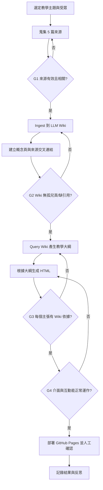

# Loop / Graph 設計與回饋迴圈

## 重複節點（Loop）
1. B↔C：遇到來源不相關、重複、無法查核，重新選資料。
2. D→E→F→D：概念頁孤立、漏來源或有矛盾，修正 Wiki 再檢查。
3. G→H→I→G：簡報內容不是 Wiki 所載，回到 query/大綱重寫，不先修 CSS。
4. H↔J：只有按鈕、排版、手機版異常，則修 HTML，不重新 ingest。

## 為何這樣設計
將事實核對（G1/G2/G3）放在排版（G4）前，可以避免漂亮的投影片掩蓋沒有根據的內容；針對問題返回最近的上游節點，可減少每次都從頭製作的成本。

## Graph 的兩層意義
- **知識圖**：原始來源 S01–S05 → 定義/成因/風險/查核/Grounding 五個概念 → 對應投影片。
- **工作圖**：取得資料 → ingest → query → 生成 → 品質檢查；不合格沿有條件的邊返回。
